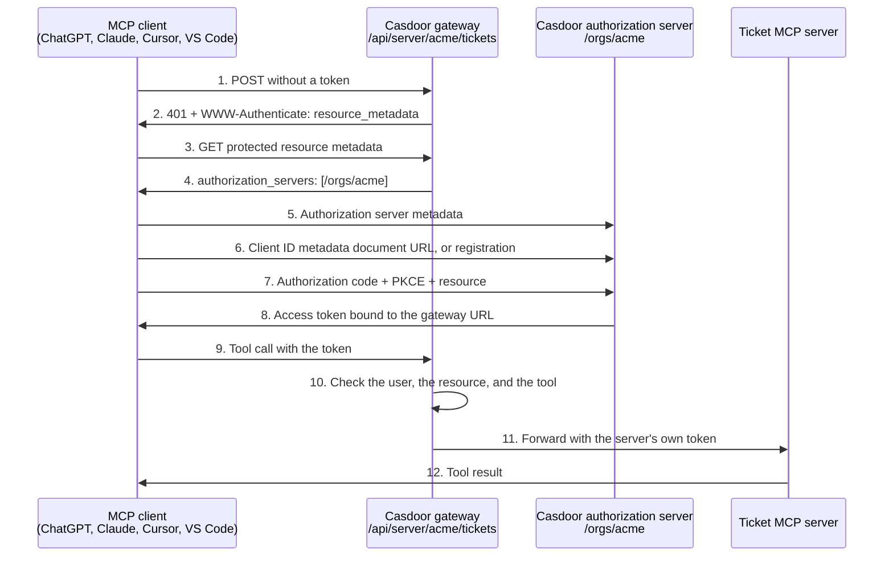

This guide walks through a complete example: a company publishes one MCP server to its employees, who use it from ChatGPT, Claude, Cursor, and VS Code. Casdoor is both the gateway in front of the server and the authorization server that signs the users in. The MCP server itself needs no OAuth 2.0 code.

---

#### Learning outcomes

- Prepare an organization so that MCP clients register and sign in there.
- Register an MCP server in Casdoor and decide who may use it and which tools.
- Connect the four common MCP clients.
- Serve several organizations from one Casdoor instance.
- Check, audit, and revoke access.

#### What you need

- A Casdoor instance reachable from the Internet over HTTPS, for example `https://auth.example.com`. ChatGPT and Claude custom connectors call it from the cloud.
- An MCP server that speaks the Streamable HTTP transport, for example `https://tickets.example.com/mcp`, optionally protected by a static bearer token
- Global administrator access to the Casdoor admin console

---

## The example

Acme runs an MCP server for its ticket system. Acme wants:

- Employees sign in with their Acme account, through the sign-in methods that Acme already set up in Casdoor.
- Only the support team may use the server.
- Nobody may call the tool `delete_ticket` through an AI client.
- The server's own API token never leaves Casdoor.
- An administrator can see and revoke each client.



## Step 1: prepare the organization {#prepare-the-organization}

1. In the Casdoor admin console, go to **User Management** > **Organizations** and open `acme`.
1. Turn on **Use organization issuer**. The organization becomes its own authorization server, with the issuer `https://auth.example.com/orgs/acme` and the discovery document `https://auth.example.com/.well-known/oauth-authorization-server/orgs/acme`. MCP clients that discover it register in `acme` and sign users in on the sign-in page of `acme`.
1. Turn on **Enable dynamic client registration**. This lets clients identify themselves with a client ID metadata document (Claude, VS Code, ChatGPT) or register themselves (Cursor, older clients). Only a global administrator can change this switch.
1. Save the organization.

Without **Use organization issuer**, the gateway names the global issuer of Casdoor as the authorization server, and clients register in `built-in`. Turn it on for every organization other than `built-in` that publishes MCP servers.

## Step 2: decide who may use the server {#decide-who-may-use-the-server}

The gateway lets in the users of the server's organization who may sign in to the server's application.

1. Go to **Identity** > **Applications** and add an application in `acme`, for example `app-tickets`. It needs no redirect URLs: MCP clients don't sign in to it, it only carries the access rules.
1. To let only the support team in, go to **Authorization** > **Permissions** and add a permission in `acme`:
   - **Resource type**: `Application`
   - **Resources**: `app-tickets`
   - **Groups** or **Roles**: the support team
   - **Actions**: `Read`, **Effect**: `Allow`

Without any permission on the application, every user of `acme` may use the server. Administrators of `acme` and global administrators may always use it.

## Step 3: register the MCP server {#register-the-mcp-server}

1. Go to **LLM AI** > **MCP Servers** and add a server in `acme`:

   | Field | Value |
   |---|---|
   | **Name** | `tickets` |
   | **URL** | `https://tickets.example.com/mcp` |
   | **Application** | `app-tickets` |
   | **Access token** | The API token of the ticket server, if it needs one |

1. Save the server, and then select **Sync** under **Tool**. Casdoor fetches the tool list of the server.
1. Block `delete_ticket` and save. The gateway answers a call to a blocked tool, or to a tool that isn't in the list, with an error and doesn't forward it.
1. Copy the **Base URL**: `https://auth.example.com/api/server/acme/tickets`. This is the URL that users add to their MCP clients.

The gateway removes the `Cookie` header and the user's `Authorization` header from each request, and sends the **Access token** of the server instead. Casdoor never returns the token in its API responses.

:::note
For a server of an organization other than `built-in`, the **URL** must be a public Internet address: the gateway refuses to reach private and loopback addresses on behalf of a tenant. To publish an MCP server on your internal network, register it in `built-in`.
:::

## Step 4: check the discovery chain {#check-the-discovery-chain}

Every MCP client follows the same chain. Check it with `curl` before you connect a client:

```bash
curl -i -X POST https://auth.example.com/api/server/acme/tickets
```

Casdoor answers HTTP 401 and names the protected resource metadata of this server:

```text
WWW-Authenticate: Bearer realm="casdoor", resource_metadata="https://auth.example.com/.well-known/oauth-protected-resource/api/server/acme/tickets"
```

```bash
curl https://auth.example.com/.well-known/oauth-protected-resource/api/server/acme/tickets
```

```json
{
  "resource": "https://auth.example.com/api/server/acme/tickets",
  "authorization_servers": ["https://auth.example.com/orgs/acme"],
  "bearer_methods_supported": ["header"],
  "scopes_supported": ["openid", "profile", "email", "offline_access"]
}
```

```bash
curl https://auth.example.com/.well-known/oauth-authorization-server/orgs/acme
```

In this document, check:

- `issuer` is `https://auth.example.com/orgs/acme`, the same value as in `authorization_servers`.
- `client_id_metadata_document_supported` is `true`, and `registration_endpoint` ends with `?organization=acme`.
- `token_endpoint_auth_methods_supported` contains `none`, and `code_challenge_methods_supported` contains `S256`.

## Step 5: connect the clients {#connect-the-clients}

Each user adds the gateway URL to their client and signs in with their Acme account.

| Client | Where to add the server | How it identifies itself | Guide |
|---|---|---|---|
| ChatGPT | **Plugins** > **+** > **Add custom MCP server** | CIMD `https://chatgpt.com/oauth/client.json` | [Connect ChatGPT](/docs/how-to-connect/mcp/connect-chatgpt) |
| Claude Desktop, claude.ai | **Customize** > **Connectors** > **Add custom connector** | CIMD `https://claude.ai/oauth/mcp-oauth-client-metadata` | [Connect Claude](/docs/how-to-connect/mcp/connect-claude-desktop) |
| Claude Code | `claude mcp add --transport http tickets <url>` | CIMD `https://claude.ai/oauth/claude-code-client-metadata` | [Connect Claude](/docs/how-to-connect/mcp/connect-claude-desktop#claude-code) |
| Cursor | `~/.cursor/mcp.json` | DCR | [Connect Cursor](/docs/how-to-connect/mcp/connect-cursor) |
| VS Code | `.vscode/mcp.json` | CIMD `https://vscode.dev/oauth/client-metadata.json` | [Connect VS Code](/docs/how-to-connect/mcp/connect-vscode) |
| DeepSeek Harness | The **Casdoor** page of its Casdoor plugin, which lists the servers | The application and agent of its [Marketplace](/docs/marketplace/overview) integration (Commercial edition) | [Connect DeepSeek Harness](/docs/how-to-connect/mcp/connect-deepseek-harness) |

For example, in Cursor:

```json
{
  "mcpServers": {
    "tickets": {
      "url": "https://auth.example.com/api/server/acme/tickets"
    }
  }
}
```

And in VS Code:

```json
{
  "servers": {
    "tickets": {
      "type": "http",
      "url": "https://auth.example.com/api/server/acme/tickets"
    }
  }
}
```

A client that uses a client ID metadata document gets one application in Casdoor, with its URL as the client ID, the tag `cimd`, and a name that starts with `cimd_`. A client that registers itself gets one application per registration, with the tag `dcr`. You don't create applications for the clients.

## What protects the server {#what-protects-the-server}

| Check | Where | What happens otherwise |
|---|---|---|
| The token belongs to a user of `acme` | Gateway | HTTP 401 |
| The user may sign in to `app-tickets` | Gateway | HTTP 401 |
| The token was issued for this server ([RFC 8707](https://www.rfc-editor.org/rfc/rfc8707)) | Gateway | HTTP 401: "The access token is for another resource" |
| The tool is in the list and allowed | Gateway | JSON-RPC error, the call isn't forwarded |
| The client is a client that registered itself | Every API | Its tokens can only call the sign-in flow, `/api/userinfo`, `/api/mcp`, and `/api/server/*`, never the management APIs |

Clients request the token with `resource=https://auth.example.com/api/server/acme/tickets`, and Casdoor puts that URL in the `aud` claim. A token for another MCP server, even one of the same organization, doesn't work here, so a malicious server can't replay the tokens that it receives.

## Serve several organizations {#serve-several-organizations}

One Casdoor instance can publish MCP servers for many organizations, for example the customers of a SaaS. Repeat steps 1 to 3 for each organization. Then:

- Each organization has its own issuer, sign-in page, users, and permissions. A user of `globex` can't sign in on the page of `acme` and can't use the servers of `acme`.
- The client ID metadata documents of ChatGPT, Claude, and VS Code have one URL each, used by all organizations. Casdoor keeps one shared application per URL in `built-in` and serves it as an application of the organization that the user signs in to. Each organization must still turn on **Enable dynamic client registration** to accept these clients.
- Tokens carry the issuer of the user's organization, also after a refresh.
- A client that registers itself (DCR) registers in the organization of the discovery document, through the `organization` parameter of the registration endpoint.

## Check, audit, and revoke {#check-audit-and-revoke}

- **Clients**: **Identity** > **Applications** lists the clients with the tags `cimd` and `dcr`. Delete a `dcr_` application to remove a registration.
- **Tokens**: **Auditing** > **Tokens** lists each token with its user, application, scope, and resource. Delete a token to cut a client off at once.
- **Users**: Forbid a user, and their tokens stop working at the gateway on the next request.
- **Tools**: Block a tool on the server's edit page. The change takes effect on the next call.

## Let enterprise users skip the browser {#enterprise-managed-authorization}

When the employees of an organization sign in through an enterprise identity provider such as Okta, the clients that support Enterprise-Managed Authorization (Claude Team and Enterprise) can get the gateway token without a browser sign-in: the identity provider issues an ID-JAG, and Casdoor exchanges it for an access token. See [Enterprise-managed authorization](/docs/mcp-auth/enterprise-managed-authorization).

## Troubleshooting {#troubleshooting}

### The gateway answers 401 after the sign-in

- The server has no **Application**. Without one, only administrators may use the server. Select an application, see [Step 2](/docs/how-to-connect/mcp/gateway#decide-who-may-use-the-server).
- A permission on the application excludes the user.
- The user belongs to another organization than the server.
- The client requested the token for another resource. Check the `aud` claim of the token: it must be the gateway URL.

### The client signs users in on the wrong organization

**Use organization issuer** is off, so the protected resource metadata names the global issuer. Turn it on, and reconnect the client.

### "client ID metadata documents are not accepted"

**Enable dynamic client registration** is off for the organization. Casdoor must also reach the document URL of the client over the Internet.

### The gateway answers 502

Casdoor can't reach the **URL** of the server. Check the URL and, for an organization other than `built-in`, that it is a public address.

## See also

- [The MCP server of Casdoor](/docs/how-to-connect/mcp/overview)
- [Register clients dynamically](/docs/application/dynamic-client-registration)
- [Use Casdoor as the authorization server of your own MCP server](/docs/mcp-auth/overview)
- [Enterprise-managed authorization](/docs/mcp-auth/enterprise-managed-authorization)
