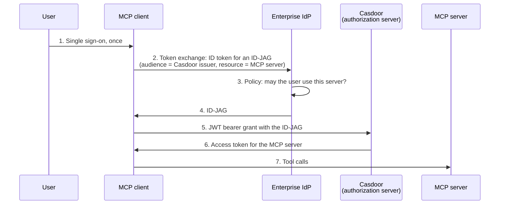

This guide explains Enterprise-Managed Authorization, an extension of the MCP authorization specification for companies: the enterprise identity provider (IdP) decides which MCP servers an employee may use, and the MCP client gets its tokens without a browser sign-in at each server. Casdoor takes either role:

- **The authorization server of MCP servers**: Casdoor accepts the ID-JAGs of an enterprise IdP that an organization trusts.
- **The enterprise IdP**: Casdoor issues ID-JAGs for MCP servers whose authorization server trusts it.

---

#### Learning outcomes

- Understand the flow and what an ID-JAG is.
- Let an organization of Casdoor trust the ID-JAGs of an enterprise IdP.
- Issue ID-JAGs from Casdoor.

#### What you need

- Global administrator access to the Casdoor admin console
- An MCP client that supports the extension, for example Claude Team or Enterprise with Okta Cross App Access

---

## How it works {#how-it-works}

An ID-JAG (Identity Assertion JWT Authorization Grant) is a short-lived JWT that the IdP signs. It says: this user may use this client at this authorization server. It is defined in [draft-ietf-oauth-identity-assertion-authz-grant](https://datatracker.ietf.org/doc/draft-ietf-oauth-identity-assertion-authz-grant/), and the MCP extension `io.modelcontextprotocol/enterprise-managed-authorization` builds on it. See [Enterprise-Managed Authorization](https://modelcontextprotocol.io/extensions/auth/enterprise-managed-authorization).



The user never sees the sign-in page of Casdoor. When the IdP stops the user, for example after they leave the company, the client gets no new ID-JAG, and no new access token.

## Accept ID-JAGs in Casdoor {#accept-id-jags}

### Trust the IdP

1. In the Casdoor admin console, go to **User Management** > **Organizations** and open the organization of the users, for example `acme`.
1. Optionally, turn on **Use organization issuer**, so that the organization has its own issuer, `https://your-casdoor.com/orgs/acme`. Otherwise, the issuer is the global one, `https://your-casdoor.com`.
1. Under **Trusted ID-JAG issuers**, add a row:

   | Column | Value |
   |---|---|
   | **Issuer** | The `iss` of the ID-JAGs, for example `https://acme.okta.com` |
   | **JWKS URL** | The key set of the IdP. If you leave it empty, Casdoor reads `jwks_uri` from `<issuer>/.well-known/openid-configuration` |
   | **User** | How to find the user in the organization: `{email}` (the default) takes the `email` claim, `{sub}` the `sub` claim, any `{claim}` that claim. Casdoor matches it against the user name, email, phone, and ID |

1. Save the organization. Only a global administrator can change the trusted issuers.

In the IdP, give Casdoor the issuer of the organization as the audience of the ID-JAGs, and the MCP server URLs as resources. For a server behind the [MCP gateway](/docs/how-to-connect/mcp/gateway), that is `https://your-casdoor.com/api/server/acme/<server-name>`.

### Let the client use the grant

The client redeems the ID-JAG at the token endpoint with the JWT bearer grant (`urn:ietf:params:oauth:grant-type:jwt-bearer`), so the grant type must be allowed for its application:

- **Claude**: Its client ID metadata document `https://claude.ai/oauth/mcp-oauth-client-metadata` lists the grant. Turn on **Enable dynamic client registration** for the organization, so that Casdoor accepts the document. See [Connect Claude](/docs/how-to-connect/mcp/connect-claude-desktop#accept-claude-in-casdoor).
- **An application that you create**: Add **JWT Bearer** to its **Grant types**.

### What the client sends

```bash
curl -X POST https://your-casdoor.com/api/login/oauth/access_token \
  -d grant_type=urn:ietf:params:oauth:grant-type:jwt-bearer \
  -d client_id=<client-id> \
  -d client_secret=<client-secret> \
  -d assertion=<ID-JAG>
```

Casdoor answers with an access token whose audience is the `resource` of the ID-JAG:

```json
{
  "access_token": "eyJhbGciOiJSUzI1NiIs...",
  "token_type": "Bearer",
  "expires_in": 604800,
  "scope": "openid profile"
}
```

### What Casdoor checks {#what-casdoor-checks}

| Check | Rule |
|---|---|
| Type | The JWT header has `typ: oauth-id-jag+jwt`. Other assertions go through the ordinary [JWT bearer grant](/docs/how-to-connect/oauth) |
| Client | A confidential client authenticates, with its client secret or `private_key_jwt`. A public client of a client ID metadata document, such as Claude, has no secret and sends only `client_id` |
| Audience | `aud` is the issuer of an organization with its own issuer, or the global issuer, which stands for the organization of the client's application |
| Issuer and signature | `iss` is a trusted issuer of that organization, and the key with the `kid` of the header in its JWKS verifies the signature |
| Lifetime | `exp` and `iat` are present and valid, with one minute of leeway |
| Client binding | `client_id` equals the client ID of the client that redeems it |
| Single use | Casdoor accepts each `jti` of an issuer once |
| User | The user found through **User** exists in the organization, isn't forbidden, and may sign in to the client's application |
| Scope | A `scope` in the request must be a subset of the `scope` of the ID-JAG. Without one, the token gets the scope of the ID-JAG |
| Resource | `resource`, when present, becomes the audience of the access token |

A client that registered itself (DCR) or uses a client ID metadata document can use the JWT bearer grant only with an ID-JAG.

### Errors

| Error | Cause |
|---|---|
| `invalid_client` | A confidential client didn't authenticate |
| `invalid_grant` | The ID-JAG failed one of the checks: wrong audience, untrusted issuer, bad signature, expired, issued to another client, used before, or the user doesn't exist |
| `invalid_scope` | The request asks for a scope that the ID-JAG doesn't grant |
| `invalid_target` | The `resource` of the ID-JAG isn't an absolute URI |
| `unsupported_grant_type` | **JWT Bearer** isn't among the grant types of the client's application |

The authorization server metadata announces the support: `grant_types_supported` contains `urn:ietf:params:oauth:grant-type:jwt-bearer`, and `authorization_grant_profiles_supported` contains `urn:ietf:params:oauth:grant-profile:id-jag`.

## Issue ID-JAGs from Casdoor {#issue-id-jags}

When Casdoor is the IdP of the company, a client exchanges the ID token of the user for an ID-JAG at the token endpoint of Casdoor, with token exchange ([RFC 8693](https://www.rfc-editor.org/rfc/rfc8693)):

```bash
curl -X POST https://your-casdoor.com/api/login/oauth/access_token \
  -d grant_type=urn:ietf:params:oauth:grant-type:token-exchange \
  -d client_id=<client-id> \
  -d client_secret=<client-secret> \
  -d requested_token_type=urn:ietf:params:oauth:token-type:id-jag \
  -d subject_token=<ID token of the user> \
  -d subject_token_type=urn:ietf:params:oauth:token-type:id_token \
  -d audience=https://mcp-as.example.com \
  -d resource=https://mcp.example.com/mcp \
  -d scope="openid profile"
```

```json
{
  "issued_token_type": "urn:ietf:params:oauth:token-type:id-jag",
  "access_token": "eyJ0eXAiOiJvYXV0aC1pZC1qYWcrand0Ii...",
  "token_type": "N_A",
  "expires_in": 300,
  "scope": "openid profile"
}
```

Set it up as follows:

1. Add **Token Exchange** to the **Grant types** of the client's application.
1. Register the MCP server on the **LLM AI** > **MCP Servers** page of the user's organization, with its URL as the `resource`, and select an **Application** that stands for it. Without a `resource`, Casdoor finds the application by the `audience`, as a client ID or an application name.
1. Grant the users access: add a permission with **Resource type** `Application`, the server's application as the resource, and **Effect** `Allow`. Casdoor issues an ID-JAG only to a user that an `Allow` permission covers, so an application that nobody is granted stays closed.

The ID-JAG is valid for 5 minutes. Its `aud` is the `audience` of the request, `client_id` is the client ID of the requesting application, and it carries the user's `email`, the `resource`, and the `scope`. The authorization server of the MCP server must trust the issuer of Casdoor, and the client must use the same client ID there, for example the URL of its client ID metadata document.

## See also

- [Put MCP servers behind the Casdoor MCP gateway](/docs/how-to-connect/mcp/gateway)
- [Use Casdoor as the authorization server of your own MCP server](/docs/mcp-auth/overview)
- [Register clients dynamically](/docs/application/dynamic-client-registration)
- [Enterprise-managed authorization](https://claude.com/docs/connectors/building/enterprise-managed-auth) in the Claude documentation
